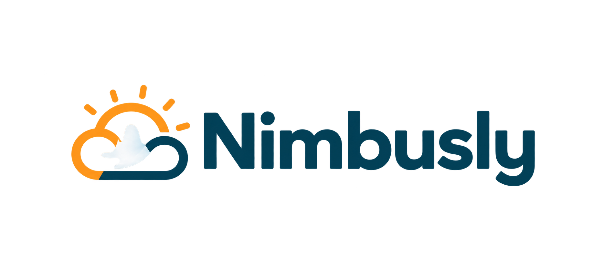

  

  
A responsive weather dashboard with live conditions, local time and a five-day forecast.

  

    <a href="https://nimbusly-app.netlify.app/"><strong>View live demo</strong></a>
    ·
    <a href="https://github.com/vanessateixeira92/react-weather-app/issues">Report an issue</a>
  

About the project
Nimbusly is a responsive weather application built with React. Users can search for a city and view its current weather, local date and time, temperature, feels-like temperature, humidity, wind speed and five-day forecast.

The interface combines a mountain landscape with glassmorphism-inspired cards, animated weather icons and layouts adapted for desktop, tablet and mobile screens.
Features

- Search weather information by city
- Display current temperature and weather conditions
- Show feels-like temperature, humidity and wind speed
- Display the searched city's local day and time
- Five-day weather forecast
- Animated weather icons for different conditions and day/night states
- Clear-search button and user-friendly loading and error messages
- Responsive layouts for desktop, tablet and mobile devices
  Built with
- React
- JavaScript
- CSS
- Bootstrap
- Axios
- SheCodes Weather API
- Lottie animations
- Lucide React
- tz-lookup
- Netlify
  Getting started
  Prerequisites
  Make sure that Node.js and npm are installed on your computer.
  Installation

1. Clone the repository:
   git clone https://github.com/vanessateixeira92/react-weather-app.git
2. Open the project directory:
   cd react-weather-app
3. Install the dependencies:
   npm install
4. Create a .env.local file in the project root:
   REACT_APP_SHECODES_API_KEY=your_api_key_here
5. Start the development server:
   npm start
6. Open http://localhost:3000 in your browser.
   Do not commit .env.local or share your API key publicly. Add the same environment variable in your hosting provider when deploying the application.

Available scripts
Command Description
npm start Runs the app in development mode.
npm test Launches the test runner in interactive watch mode.
npm run build Creates an optimized production build.

Project structure
src/
├── animations/ # Lottie weather animations
├── images/ # Background image
├── App.js # Main application layout
├── FormattedDate.js # Local date and time formatting
├── Weather.js # Search, API request and application state
├── WeatherForecast.js # Five-day forecast
├── WeatherIcon.js # Weather animation selection
├── WeatherInfo.js # Current weather details
└── \*.css # Component and responsive styles
Deployment
The project is deployed on Netlify:

https://nimbusly-app.netlify.app/

For the deployed application to access the API, add the following environment variable in Netlify and redeploy the site:
REACT_APP_SHECODES_API_KEY
What I learned
This project helped me practise:

- Building reusable React components
- Managing state and side effects with React Hooks
- Fetching and handling data from external APIs
- Formatting dates across different time zones
- Creating responsive interfaces with Bootstrap and CSS media queries
- Handling loading and error states
- Managing environment variables and deploying a React application
  Author
  Developed by Vanessa Teixeira.
- GitHub
- Live project
  Acknowledgements
  This project was created as part of the SheCodes React learning journey.
